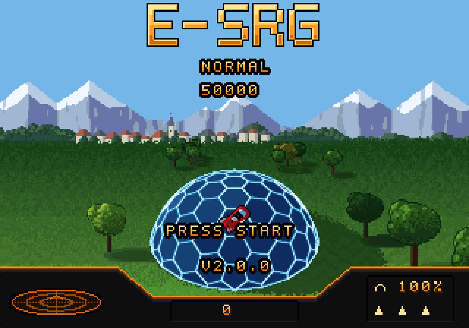
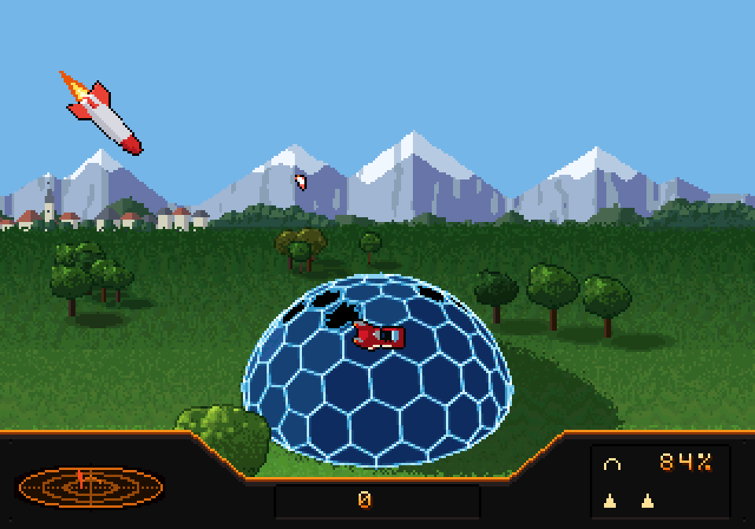

# E-SRG for the Neo Geo

A Neo Geo port of [E-SRG](https://github.com/emmulator/vectrex-e-srg), the Vectrex game about defending
a rotating geodesic dome from incoming missiles. The Vectrex draws its vector
graphics at run time; the Neo Geo can only show pre-drawn tiles, so this port
renders every view of the dome, ship and missiles ahead of time from the same
geometry and turns them into sprites.

Status: **2.0.0**, based on Vectrex E-SRG 1.1.1 (see
[CHANGELIST.md](CHANGELIST.md)). Design and milestones:
[docs/plan.md](docs/plan.md). Tested in MAME (AES and MVS); not yet on real
hardware.

[Gameplay video on YouTube](https://youtu.be/PWf-ATAZgqM)

<p>


</p>

Controls: stick moves, A fires, B jumps (on the title: changes level),
C next title page, Start starts (MVS: coin first).

```
make              # build/rom/esrg.zip, the cart
make test         # host tests
make boot-test    # MAME boot tests
scripts/mame.sh   # play it in MAME (AES); MVS=1 for the arcade board
```

### Other MAME installs, other systems

`scripts/mame.sh` uses the MAME flatpak if it is
installed, else `mame` on your PATH. To use something else, set `MAME_CMD`
(e.g. `MAME_CMD=/opt/mame/mame`). It looks for the BIOS (`aes.zip`, or
`neogeo.zip` for `MVS=1`) in `MAME_BIOS_DIR`, then `~/ROMs/mame`,
`~/ROMs/neogeo`, `~/mame/roms`, `~/.mame/roms` and `/usr/share/mame/roms`.
Settings can be environment variables or `KEY=value` lines in
`~/.config/e-srg/config` (for when the script is started without your environment). The scripts are bash and python3: Linux, macOS and WSL; for
Windows, run MAME yourself:

```
mame -rompath <dir with aes.zip and esrg.zip> -hashpath <dir with neogeo.xml> \
     aes -cart esrg -memcard esrg.neo
```

where `neogeo.xml` is made by `python3 scripts/mame_softlist.py esrg.zip <dir>
--name esrg --description E-SRG` (MAME loads a loose ngdevkit cart through a
software list entry).

Toolchain: [ngdevkit](https://github.com/dciabrin/ngdevkit) (68000 gcc,
tiletool, paltool, adpcmtool); emulators: MAME, gngeo.

## Credits

The typewriter strike on the high-score entry is a CC0 recording from
Freesound; see [CREDITS.md](CREDITS.md).

## License

GPL-3.0-or-later; see [LICENSE](LICENSE).
